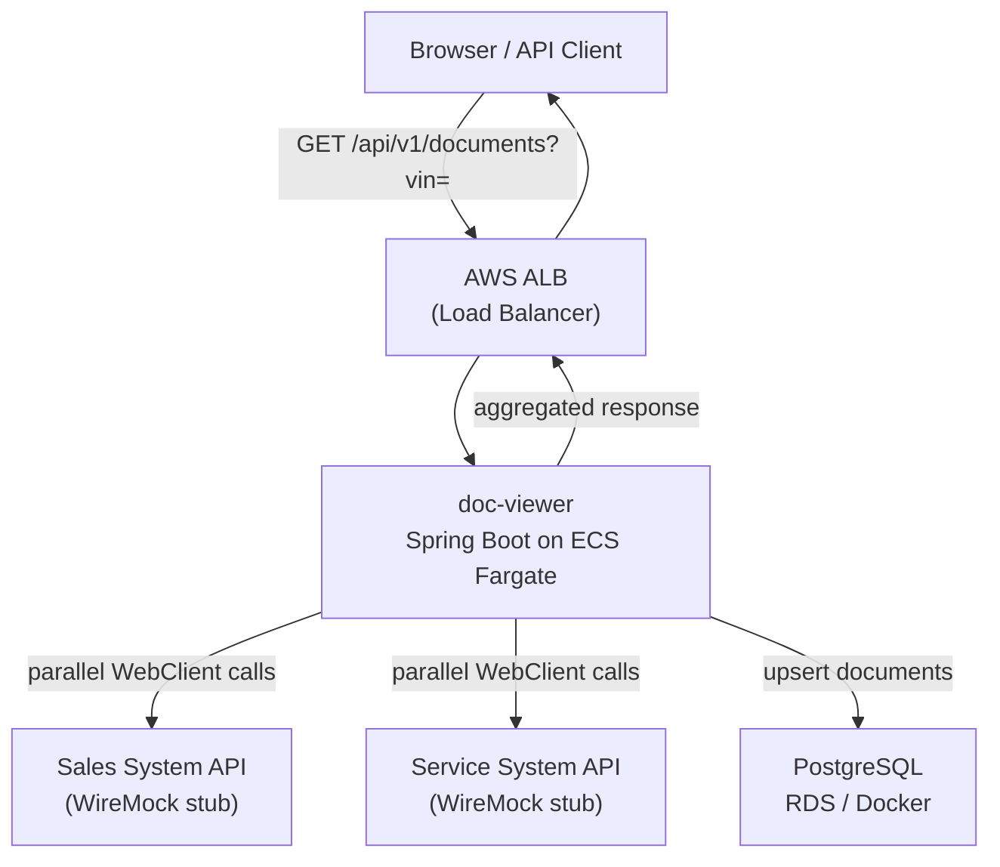
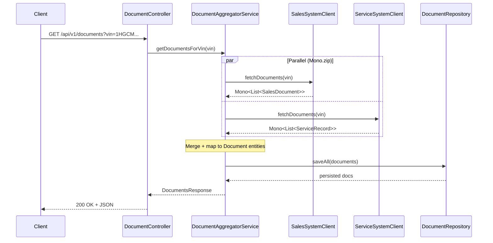

# System Design: Unified Document Viewer

> **Domain:** Operate  
> **Goal:** Single view of all documents related to a vehicle, aggregated from two dealership systems.

---

## Step 1 — Clarify Requirements

### Core Requirements (confirmed)

| # | Requirement | Notes |
|---|---|---|
| R1 | Search by VIN | 17-char ISO 3779 alphanumeric |
| R2 | Parallel fetch from Sales System API and Service System API | Must not block on one while waiting for the other |
| R3 | Unified response with source labelling | Each document tagged `SALES` or `SERVICE` |

### Assumptions (documented where requirements were ambiguous)

| Area | Assumption | Rationale |
|---|---|---|
| Traffic | ~100 concurrent users, ~500 req/min peak | MVP/proposal stage; low-to-medium load |
| Geography | Single region: `ap-southeast-1` (Singapore) | Typical ANZ/APAC automotive market |
| Authentication | Out of scope for MVP; API key header placeholder in OpenAPI spec | Requirement not stated; add via API Gateway in production |
| VIN uniqueness | One VIN → one vehicle; documents from both systems can share the same VIN | Standard assumption |
| External API availability | Best-effort SLA; partial results are acceptable | Prevents full failure when one system is down |
| Data freshness | External APIs are the source of truth; no strict cache TTL for MVP | Fetched documents are persisted for audit/history |
| External API contracts | Sales API returns `documents[]`; Service API returns `records[]` | Modelled after typical dealership integration patterns |
| Frontend | Not implemented; OpenAPI spec serves as contract for any consumer | Part 2 explicitly selects backend layer |
| AWS deployment | ECS Fargate + RDS PostgreSQL + ALB target | Avoids Lambda cold-start for a long-running demo; easy lift-and-shift |

---

## Step 2 — Data & APIs

### Internal API Contract

**`GET /api/v1/documents?vin={vin}`**

```json
{
  "vin": "1HGCM82633A123456",
  "totalCount": 5,
  "documents": [
    {
      "id": "3fa85f64-5717-4562-b3fc-2c963f66afa6",
      "title": "Purchase Agreement",
      "type": "CONTRACT",
      "source": "SALES",
      "createdAt": "2024-01-15T10:30:00Z",
      "url": "https://sales.example.com/docs/sale-001.pdf"
    }
  ],
  "sources": {
    "SALES":   { "status": "OK",    "count": 2 },
    "SERVICE": { "status": "ERROR", "count": 0, "errorMessage": "Connection timeout" }
  }
}
```

Error responses follow **RFC 7807 Problem Details**:

```json
{
  "type": "about:blank",
  "title": "Validation Error",
  "status": 400,
  "detail": "getDocumentsByVin.vin: VIN must be exactly 17 characters"
}
```

### External API Contracts (mocked)

**Sales System — `GET /sales/api/documents?vin={vin}`**

```json
{
  "documents": [
    { "id": "sale-001", "title": "Purchase Agreement", "documentType": "CONTRACT",
      "date": "2024-01-15T10:30:00Z", "downloadUrl": "https://..." }
  ]
}
```

**Service System — `GET /service/api/documents?vin={vin}`**

```json
{
  "records": [
    { "recordId": "svc-001", "description": "Oil Change", "category": "MAINTENANCE",
      "serviceDate": "2024-06-20T09:00:00Z", "documentUrl": "https://..." }
  ]
}
```

### Database Schema

```sql
CREATE TABLE documents (
    id          UUID         PRIMARY KEY,
    vin         VARCHAR(17)  NOT NULL,
    title       VARCHAR(500),
    type        VARCHAR(100),
    source      VARCHAR(20)  NOT NULL,   -- 'SALES' | 'SERVICE'
    created_at  TIMESTAMPTZ,
    url         TEXT,
    fetched_at  TIMESTAMPTZ  NOT NULL DEFAULT NOW()
);

CREATE INDEX idx_documents_vin        ON documents (vin);
CREATE INDEX idx_documents_vin_source ON documents (vin, source);
```

Document IDs are **deterministic UUIDs** derived from `source + externalId` so re-fetching the same record performs an upsert without creating duplicates.

---

## Step 3 — Architecture

### Component Diagram



### Request Data Flow



### Component Roles

| Component | Technology | Role |
|---|---|---|
| **DocumentController** | Spring MVC `@RestController` | Validates VIN input, delegates to service, serialises response |
| **DocumentAggregatorService** | Spring `@Service` | Core orchestration: parallel fetch, merge, persist, error isolation |
| **SalesSystemClient** | Spring WebClient | Non-blocking HTTP client for Sales System API |
| **ServiceSystemClient** | Spring WebClient | Non-blocking HTTP client for Service System API |
| **DocumentRepository** | Spring Data JPA | Upsert and query of persisted documents |
| **PostgreSQL** | Docker / AWS RDS | Persistent document store with VIN index |
| **WireMock** | WireMock standalone | Mocks both external APIs for local demo and integration tests |
| **GlobalExceptionHandler** | `@RestControllerAdvice` | Translates validation errors and exceptions to RFC 7807 responses |

---

## Step 4 — Scale & Edge Cases

### Parallel Fetch Strategy

Both external API calls are composed using **`Mono.zip()`** from Project Reactor. This means:
- Both HTTP requests fire simultaneously on the default Reactor scheduler.
- Combined latency ≈ `max(sales_latency, service_latency)` rather than their sum.
- Each call independently wrapped with `.timeout(5s)` and `.onErrorResume()` — a failure in one does **not** cancel the other.

### Graceful Degradation

If either external system fails (timeout, 5xx, network error):
- The failing source's documents are excluded from the response.
- The `sources` field in the response records the ERROR status and error message.
- HTTP 200 is still returned — the consumer always gets the best-available data.

### High Availability (production path)

| Concern | Solution |
|---|---|
| Multiple app instances | ECS Fargate with desired count ≥ 2 across AZs |
| Database HA | RDS Multi-AZ with read replicas |
| External API circuit breaker | Resilience4j CircuitBreaker (next iteration) |
| Rate limiting | AWS API Gateway throttling |
| Caching | ElastiCache Redis for hot VINs (next iteration) |

### Edge Cases Handled

- **Invalid VIN** → `@Pattern` validation → 400 with Problem Details
- **Blank VIN** → `@NotBlank` → 400
- **Null response body from external API** → mapped to empty list defensively
- **Unparseable date string** → logged as warning, `createdAt` set to null (document still returned)
- **Duplicate documents across re-fetches** → deterministic UUID + JPA `saveAll` (upsert by PK)

---

## Step 5 — Wrap-up

### Technology Choices

| Technology | Version | Justification |
|---|---|---|
| **Java** | 21 LTS | Required; virtual threads available for future async improvements |
| **Spring Boot** | 3.3.5 | De-facto standard; native AWS integration via Spring Cloud AWS |
| **Spring WebFlux (WebClient)** | — | Non-blocking HTTP for parallel external calls without thread blocking |
| **Spring Data JPA + Hibernate** | — | Productive ORM; straightforward schema evolution via DDL auto |
| **PostgreSQL** | 15 | Robust RDBMS; maps directly to AWS RDS; UUID and JSONB support |
| **Gradle (Kotlin DSL)** | 8.x | Concise, type-safe build scripts; faster incremental builds than Maven |
| **WireMock** | 3.5.4 | Industry standard for HTTP service virtualisation; used in both tests and docker-compose |
| **springdoc-openapi** | 2.6.0 | Auto-generates OpenAPI 3 spec + Swagger UI from annotations |
| **Micrometer + Brave** | — | Vendor-neutral metrics and tracing; integrates with AWS X-Ray |
| **Docker / docker-compose** | — | One-command local demo; mirrors ECS container model |

### AWS Alignment

```
Local (docker-compose)          →   AWS (production)
──────────────────────────────────────────────────────
Spring Boot container           →   ECS Fargate task
PostgreSQL container            →   RDS PostgreSQL Multi-AZ
WireMock container              →   Real Sales/Service System APIs
STDOUT JSON logs                →   CloudWatch Logs (log group per service)
Micrometer metrics              →   CloudWatch Metrics / Prometheus + Grafana
Brave tracing                   →   AWS X-Ray (via OTEL collector sidecar)
docker-compose port 8080        →   ALB + Target Group
```

---

## Observability Strategy

### Logging

- **Format:** Structured JSON via Logback (`JsonEncoder`) in production; human-readable pattern for development.
- **Correlation:** Each request logs `vin`, request path, HTTP method, and duration.
- **Key log events:** External API call initiated, external API responded (with doc count and duration), aggregation complete, errors with stack traces.

### Metrics (Micrometer)

| Metric | Type | Labels |
|---|---|---|
| `docviewer.documents.fetched` | Counter | `source` (SALES/SERVICE), `vin` |
| `docviewer.aggregation.duration` | Timer | — |
| `docviewer.external.errors` | Counter | `source` |
| JVM, HTTP, DB pool metrics | — | Spring Boot Actuator auto-config |

Exposed at: `GET /actuator/metrics`, `GET /actuator/health`

### Distributed Tracing

- Micrometer Tracing + Brave creates `traceId` / `spanId` propagated via B3 headers.
- `traceId` included in all log lines via MDC pattern.
- In production: forward to AWS X-Ray via OpenTelemetry Collector sidecar.

---

## GenAI / AI Agent Contribution

This document and the accompanying implementation were produced with AI assistance. Here is how the AI agent (Antigravity / Gemini) participated in the design phase:

### What the AI did

| Design Step | AI Contribution |
|---|---|
| **Requirements analysis** | Identified ambiguities in the spec (auth, traffic, regions) and proposed a structured assumptions table |
| **API contract design** | Designed the unified response schema, including the `sources` partial-failure field |
| **Architecture selection** | Compared Lambda vs ECS Fargate and recommended Fargate for demo simplicity with easy lift-and-shift |
| **Parallel fetch strategy** | Proposed `Mono.zip()` over `CompletableFuture` for cleaner composition and independent error isolation |
| **Schema design** | Suggested deterministic UUID as PK to enable upsert-safe re-fetching |
| **Test strategy** | Designed WireMock-based integration tests with `@DynamicPropertySource` for port isolation |
| **Code generation** | Generated all Java source files, Gradle build, Docker files, and WireMock stubs in one session |
| **Risk identification** | Flagged VIN validation, null response handling, and unparseable timestamps as edge cases |

### Human oversight applied

- Reviewed and approved the overall architecture before code generation began.
- Validated technology choices against the technical guidelines (Java, AWS alignment, simplicity-first).
- Confirmed graceful degradation behaviour (partial 200 vs full failure) as the correct product decision.
- Will verify test coverage and run the full build before submission.

